<div align="center">



<br/>

[](https://github.com/mohamadrojib278/jibsz-tunnel-autoinstall)

<br/>


</div>

> **Jibsz Tunnels (J1BTNL Edition)** adalah paket **Autoscript Tunneling Multi-Protokol** & **Web Panel Mobile-First** khusus **VPS IP Public** dan **VPS NAT (Cloudflare Zero Trust)**. Dilengkapi kontrol akses **Publik Read-Only + Login Admin**, **Auto-Block Device & Kuota Real-Time**, serta optimasi **Stabilitas Jangka Panjang** agar server tetap ringan, responsif, dan anti-lockout.

## ✨ Keunggulan Utama

- **Web Panel Publik + Login Admin:** Semua orang dapat mengakses panel untuk melihat **Dashboard**, **Buat Akun** (dengan limit default server), dan **Sistem**, sedangkan seluruh perubahan sensitif terkunci khusus untuk **Admin**.
- **Hostname Dinamis Otomatis:** Badge hostname di pojok kanan atas otomatis mengikuti domain atau IP yang sedang dibuka di browser, lengkap dengan salin 1-klik.
- **Auto-Block Device & Kuota Real-Time:** Memblokir akun otomatis (Xray & Linux SSH) ketika jumlah IP/perangkat aktif melebihi `Devices Limit` atau pemakaian trafik mencapai `Quota GB`.
- **Hardening Stabilitas Jangka Panjang:** Pembacaan log hemat RAM (`tail` byte-seek), `logrotate` + auto-truncate 10 MB, `RotatingFileHandler`, `flock` + `timeout` pada cron, `asyncio.to_thread` non-blocking, proteksi `OOMScoreAdjust=-1000` untuk `sshd`, dan pembuatan **Swap 1 GB otomatis** pada VPS RAM kecil.
- **Fleksibel Versi Core:** Mendukung **Xray-core `v26.11.9`** (default) dengan opsi rollback 1-perintah ke **`v1.8.24` LTS** untuk kompatibilitas penuh DarkTunnel & HTTP Custom, serta auto-upgrade **OpenSSH & Dropbear** resmi distro.
- **Sinkron Web Panel & CLI:** Menggunakan database terpusat SQLite WAL (`/etc/jibsz/jibsz.db`) yang sinkron real-time dengan menu terminal VPS (`menu` / `jibsz`).

## 🔐 Matriks Hak Akses (Publik vs Admin)

| Fitur / Menu | Publik (Tanpa Login) | Admin (Login) |
| :--- | :---: | :---: |
| **Dashboard** (Statistik, Traffic, Daftar Akun, Copy Config) | ✅ Akses Penuh | ✅ Akses Penuh |
| **Buat Akun** (SSH WS, VLESS, VMess, Trojan) | ✅ Limit Default Server | ✅ Bebas Atur Limit |
| **Sistem** (CPU, RAM, Disk, Status Service) | ✅ Read-Only | ✅ + Restart Service |
| **Ubah Limit Device & Limit Kuota** (Edit Rules) | ❌ Diblokir (`403`) | ✅ Akses Penuh |
| **Renew & Reset Usage Akun** | ❌ Diblokir (`403`) | ✅ Akses Penuh |
| **Hapus Akun dari Web Panel** | ❌ Diblokir (`403`) | ✅ Akses Penuh |
| **Log Server Real-Time & Clear Log** | ❌ Tersembunyi (`403`) | ✅ Akses Penuh |
| **Setting Banner SSH, Default Limit, Backup/Restore, Ganti Password** | ❌ Tersembunyi (`403`) | ✅ Akses Penuh |

> **Kredensial Admin Bawaan:** Username `admin` | Password `jibsz123` *(segera ganti melalui menu **Setting & Backup** setelah login pertama)*.

## 🌐 Protokol & Routing Server

| Protokol | Transport | Path / ServiceName | Port Publik | Port Internal |
| :--- | :--- | :--- | :---: | :---: |
| **SSH WebSocket** | WS / WSS | `/` & `/ssh-ws` | `80` / `443` | `10015` → `109` / `22` |
| **VLESS** | WS & gRPC | `/vless` & `vless-grpc` | `80` / `443` | `10001` & `10004` |
| **VMess** | WS & gRPC | `/vmess` & `vmess-grpc` | `80` / `443` | `10002` & `10005` |
| **Trojan** | WS & gRPC | `/trojan` & `trojan-grpc` | `80` / `443` | `10003` & `10006` |
| **BadVPN UDPGW** | UDP Forwarding | Gaming / VoIP | `7300` | `127.0.0.1:7300` |
| **Web Panel** | HTTP / HTTPS | `/` | Custom Port | `0.0.0.0:<PORT>` |

## ⚡ Instalasi Cepat di VPS (Ubuntu 22.04 / Debian 12)

Jalankan perintah berikut sebagai `root` pada **VPS IP Public** maupun **VPS NAT**:

```bash
apt update && apt install -y wget curl git unzip && wget -O setup.sh https://raw.githubusercontent.com/mohamadrojib278/jibsz-tunnel-autoinstall/main/setup.sh && chmod +x setup.sh && bash setup.sh
```

**Opsi Custom Port & Pilih Versi Xray-core:**

```bash
# Menentukan port web panel khusus (cocok untuk VPS NAT)
bash setup.sh --port 8080

# Memilih atau rollback ke Xray-core v1.8.24 LTS (kompatibilitas DarkTunnel / HTTP Custom)
bash setup.sh --xray-version v1.8.24
```

## ☁️ Pengaturan Khusus VPS NAT (Cloudflare Zero Trust)

1. Buka **[Cloudflare Zero Trust Dashboard](https://one.dash.cloudflare.com/)** → **Networks** → **Tunnels** → **Create a tunnel**.
2. Salin **Tunnel Token** (`eyJhIjoi...`) ke halaman Web Wizard instalasi Jibsz saat pertama kali dibuka.
3. Pada tab **Public Hostname**, arahkan domain/subdomain kamu ke Service Type **`HTTP`** dengan URL **`localhost:80`**.
4. Pastikan fitur **WebSockets** dan **gRPC** pada dashboard Cloudflare **DNS → Network** berstatus **ON**.

## 🖥️ Perintah Manajemen CLI (Terminal VPS)

| Perintah | Deskripsi |
| :--- | :--- |
| `menu` / `jibsz` | Membuka menu utama manajemen server & monitoring real-time |
| `menu-ssh` | Kelola akun SSH WebSocket (OpenSSH & Dropbear) |
| `menu-vless` | Kelola akun VLESS WS & gRPC |
| `menu-vmess` | Kelola akun VMess WS & gRPC |
| `menu-trojan` | Kelola akun Trojan WS & gRPC |
| `menu-autodel` | Konfigurasi & jalankan Auto-Delete akun expired / idle |

<div align="center">


**Maintained by [Jibsz Tunnels (J1BTNL)](https://github.com/mohamadrojib278)** • Support & Credit Telegram: **[@admj1btnl](https://t.me/admj1btnl)**

</div>
